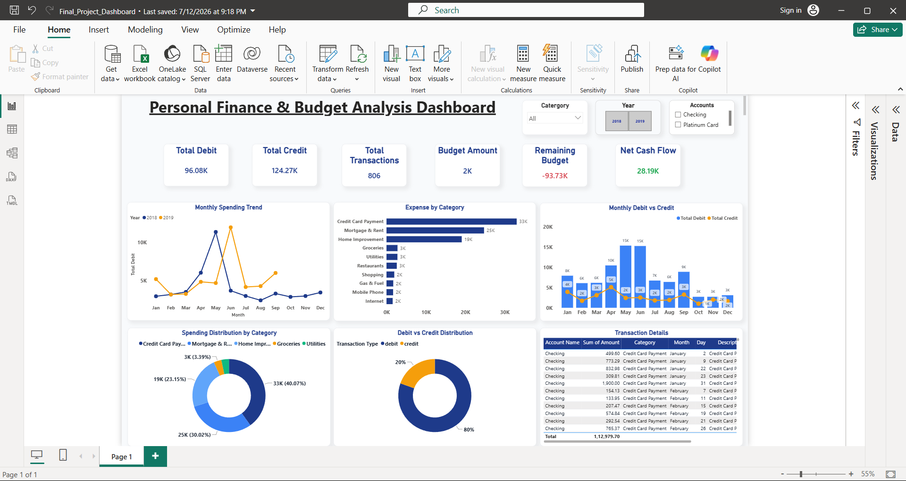

# 💰 Personal Finance & Budget Analysis Dashboard | Power BI

## 📌 Project Overview

The **Personal Finance & Budget Analysis Dashboard** is an interactive data visualization project developed using Microsoft Power BI. It provides insights into personal financial activities by analyzing debit, credit, spending patterns, budget allocation, and net cash flow.

The dashboard includes financial KPIs, monthly spending trends, category-wise expense analysis, debit vs. credit comparisons, and transaction-level details. It also allows users to explore financial data using interactive filters.

## 🎯 Project Objectives

- Analyze personal financial transactions.
- Track total debit and credit amounts.
- Monitor budget allocation and remaining budget.
- Identify monthly spending patterns.
- Compare debit and credit transactions.
- Analyze expenses across different categories.
- Evaluate net cash flow.
- Build an interactive dashboard for financial reporting.

## 🛠️ Tools & Technologies

- **Microsoft Power BI** — Dashboard development and visualization
- **DAX (Data Analysis Expressions)** — Financial KPI calculations
- **Data Modeling** — Organizing financial data for analysis
- **Data Visualization** — Charts, KPI cards, and interactive reports

## 📊 Key Performance Indicators (KPIs)

The dashboard displays six key financial metrics:

| KPI | Value |
|---|---:|
| Total Debit | 96.08K |
| Total Credit | 124.27K |
| Total Transactions | 806 |
| Budget Amount | 2K |
| Remaining Budget | -93.73K |
| Net Cash Flow | 28.19K |

*These values reflect the dashboard screenshot and may change when filters are applied.*

## 📈 Dashboard Features

### 1. Monthly Spending Trend
A line chart that visualizes monthly debit trends and compares spending patterns across 2018 and 2019.

### 2. Expense by Category
A horizontal bar chart that identifies major expense categories, including:
- Credit Card Payment
- Mortgage & Rent
- Home Improvement
- Groceries
- Utilities
- Restaurants
- Shopping
- Gas & Fuel
- Mobile Phone
- Internet

### 3. Monthly Debit vs. Credit
A combination chart that compares monthly debit and credit amounts to highlight differences in financial activity.

### 4. Spending Distribution by Category
A doughnut chart that illustrates how total spending is distributed across different expense categories.

### 5. Debit vs. Credit Distribution
A doughnut chart that presents the proportion of debit and credit transactions.

### 6. Transaction Details
A detailed transaction table containing account names, transaction amounts, categories, months, days, and descriptions.

### 7. Interactive Filters
The dashboard includes filters for:
- Category
- Year (2018 and 2019)
- Account type

These filters allow users to explore financial data according to their selected criteria.

## 🧮 DAX & Financial Analysis

DAX measures are used to calculate financial KPIs and support interactive reporting.

The dashboard focuses on:
- Total debit
- Total credit
- Total transactions
- Budget amount
- Remaining budget
- Net cash flow

## 💡 Key Insights

Based on the displayed dashboard:

- Total credit exceeds total debit.
- The dashboard reports a positive net cash flow of 28.19K.
- Credit Card Payment is the largest expense category in the displayed analysis.
- Mortgage & Rent and Home Improvement are also significant expense categories.
- Monthly debit and credit amounts vary throughout the year.
- The remaining budget KPI is negative, indicating that the displayed budget calculation requires attention.

*These observations are based on the displayed figures and may vary with the selected filters.*

## 📂 Project Structure

```text
Personal-Finance-Budget-Dashboard/
│
├── Final_Project_Dashboard.pbix
├── screenshots/
│   └── Final_Dashboard.png
└── README.md
```

*Update the filenames if your uploaded files use different names.*

## 🚀 How to Use

1. Download or clone this repository.
2. Install Microsoft Power BI Desktop.
3. Open `Final_Project_Dashboard.pbix`.
4. Explore the KPIs, charts, and transaction details.
5. Use the available filters to analyze financial data for different years, categories, and accounts.

## 📚 Skills Demonstrated

- Power BI Dashboard Development
- DAX Measures
- Financial Data Analysis
- KPI Design
- Data Visualization
- Interactive Report Design
- Expense and Budget Analysis

## 👩‍💻 Author

**Kalpna Singh**

Aspiring Data Analyst | Power BI | Excel | SQL | Python

- GitHub: [Kalpna1229](https://github.com/Kalpna1229)
- LinkedIn: [Kalpna Singh](https://www.linkedin.com/in/kalpna-singh-b9a4ba326/)

---

⭐ If you find this project useful, feel free to explore the repository!


---

## 📸 **Project Preview**



---
```
